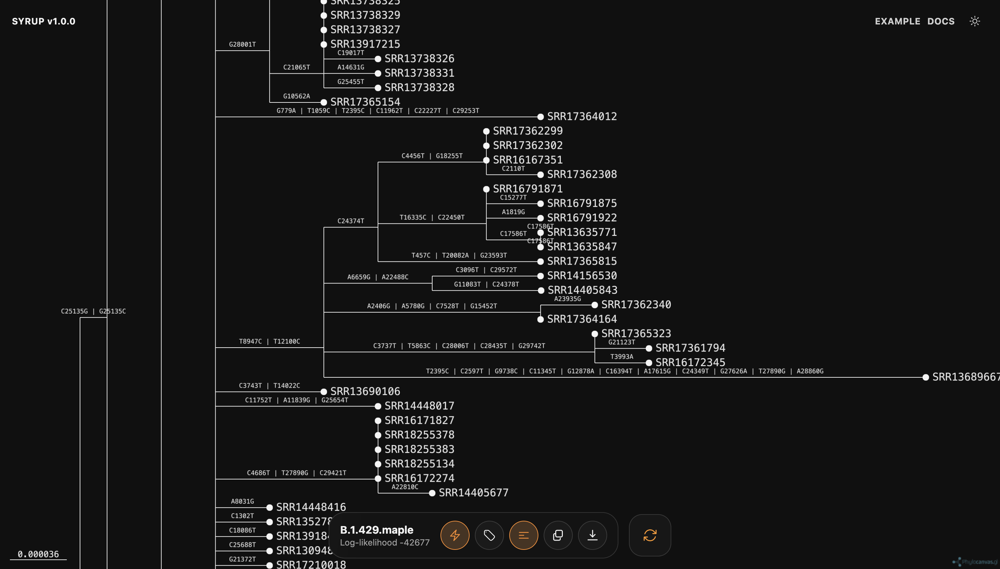

# Outputs

## Tree viewer

After inference, Syrup displays the inferred tree in an interactive viewer. The toolbar shows the input file name and the rounded log-likelihood when available.

The viewer controls can:

- show or hide inferred mutations above their branches when viewing a mutation-annotated tree
- show or hide internal labels
- show or hide leaf labels
- copy the Newick tree
- download the tree
- send the tree and its MAPLE alignment to MicrobeTrace
- return to run settings

## Newick tree

For standard runs, Syrup downloads a `.nwk` file. The same Newick text can also be copied to the clipboard.

## Mutation-annotated tree

If **Infer mutations along each branch and output a mutation-annotated tree (MAT)** is enabled, Syrup downloads a `.mat.nex` file when CMAPLE returns NEXUS output.
The interactive viewer displays inferred mutations on both internal and terminal branches. Copied Newick output retains the annotation comments used for these labels.

## MAPLE alignment

The **Download MAPLE format** link exports the loaded alignment in MAPLE format. This is available after preflight completes and before inference starts.

## Tree library

Every completed inference is kept in this browser (newest 50) with its Newick tree, NEXUS export and MAPLE alignment. The library lists them newest first; each row can copy the Newick, download the tree, rerun it in SYRUP, or remove it from the browser.

**Rerun** loads the stored MAPLE alignment back into SYRUP, so a saved run can be re-inferred without the original alignment file. **Remove** deletes the record, including its alignment, after a confirmation.

## Open in MicrobeTrace

Every completed inference is saved with its MAPLE alignment. In the tree library, select a tree and choose **Open in MicrobeTrace** to hand the Newick tree and the MAPLE alignment to MicrobeTrace through its partner embed SDK. MicrobeTrace opens the imported dataset in its 2D Network view. The files go straight from the browser to MicrobeTrace; nothing is uploaded anywhere else.

The tree library page is served without cross-origin isolation, which is what lets it load the MicrobeTrace SDK and open the partner handoff.
