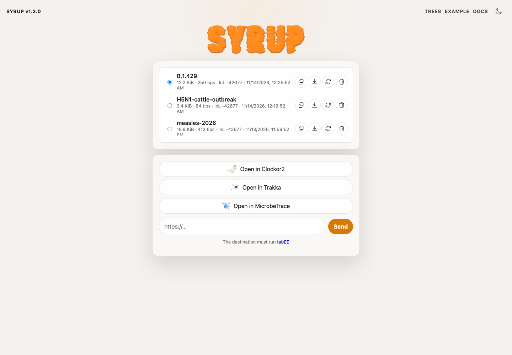

# Sharing

Syrup can open an alignment, starting tree, and starting alignment directly from URL parameters. This is useful when you want to share a reproducible browser link with collaborators.

## Tree library

Every completed inference is kept in your browser, and the tree library is where saved runs are shared from. Open it with **TREES** in the top bar, or the library icon in the tree toolbar. The page lives at `/trees.html`.



The library lists the newest 50 runs, each with its Newick tree, NEXUS export and MAPLE alignment, and never leaves the device. Select a run, then use the row actions to copy the Newick, download the tree, rerun it in Syrup, or remove it. The buttons under the list send the selected tree somewhere else:

- **Open in Clockor2** hands the tree to [Clockor2](https://clockor2.github.io/) so it can be dated without a download.
- **Open in Trakka** does the same for [Trakka](https://scout.trakka.org/).
- **Open in MicrobeTrace** sends the tree *and* its MAPLE alignment through the MicrobeTrace embed SDK.
- **Send** takes any other tabEE-enabled destination URL.

The Clockor2 and Trakka buttons use tabEE: Syrup hands the tree to the receiving app through the browser, nothing is uploaded, and the receiver asks you to approve the incoming dataset before it is imported. The receiving app must be on a build that supports tabEE. If a handoff fails, download the Newick tree and open it in the app manually.

## Host files publicly

The files must be available at public URLs that the browser can fetch. A normal GitHub repository page is not enough; use the raw file URL.

For GitHub, put the files in a public repository and use raw URLs like:

```text
https://raw.githubusercontent.com/USER/REPO/main/path/alignment.maple
https://raw.githubusercontent.com/USER/REPO/main/path/tree.nwk
```

Private repositories, local files, and URLs that block browser cross-origin requests will not work as shared Syrup links.

## URL builder

Paste public file URLs below to build a Syrup link.

<div class="syrup-url-builder" style="display: grid; gap: 0.75rem; max-width: 48rem;">
  <label>
    Alignment URL
    <input id="syrup-alignment-url" type="url" placeholder="https://raw.githubusercontent.com/USER/REPO/main/alignment.maple" style="width: 100%;">
  </label>
  <label>
    Starting tree URL
    <input id="syrup-starting-tree-url" type="url" placeholder="https://raw.githubusercontent.com/USER/REPO/main/tree.nwk" style="width: 100%;">
  </label>
  <label>
    Starting alignment URL
    <input id="syrup-starting-alignment-url" type="url" placeholder="https://raw.githubusercontent.com/USER/REPO/main/reference.maple" style="width: 100%;">
  </label>
  <label>
    Syrup link
    <textarea id="syrup-share-url" readonly rows="4" style="width: 100%;"></textarea>
  </label>
  <button id="syrup-copy-share-url" type="button">Copy link</button>
</div>

<script>
  function updateSyrupShareUrl() {
    const baseInput = 'https://syrup.cpg.org.au/' 
    const alignmentInput = document.getElementById('syrup-alignment-url')
    const startingTreeInput = document.getElementById('syrup-starting-tree-url')
    const startingAlignmentInput = document.getElementById('syrup-starting-alignment-url')
    const output = document.getElementById('syrup-share-url')
    if (!baseInput || !alignmentInput || !startingTreeInput || !startingAlignmentInput || !output) return

    try {
      const url = new URL(baseInput.value || 'https://syrup.cpg.org.au/')
      url.search = ''
      if (alignmentInput.value.trim()) url.searchParams.set('alignment', alignmentInput.value.trim())
      if (startingTreeInput.value.trim()) url.searchParams.set('startingTree', startingTreeInput.value.trim())
      if (startingAlignmentInput.value.trim()) url.searchParams.set('startingAlignment', startingAlignmentInput.value.trim())
      output.value = url.toString()
    } catch {
      output.value = ''
    }
  }

  ;['syrup-base-url', 'syrup-alignment-url', 'syrup-starting-tree-url', 'syrup-starting-alignment-url'].forEach((id) => {
    const input = document.getElementById(id)
    if (input) input.addEventListener('input', updateSyrupShareUrl)
  })

  const copyButton = document.getElementById('syrup-copy-share-url')
  if (copyButton) {
    copyButton.addEventListener('click', async () => {
      const output = document.getElementById('syrup-share-url')
      if (!output || !output.value) return
      await navigator.clipboard.writeText(output.value)
      copyButton.textContent = 'Copied'
      setTimeout(() => {
        copyButton.textContent = 'Copy link'
      }, 1200)
    })
  }

  updateSyrupShareUrl()
</script>

## Example

This link loads one new sample, a reference tree, and the reference alignment bundled with the hosted app:

```text
https://syrup.cpg.org.au/?alignment=/samples/SRR13689667.maple&startingTree=/refs/B.1.429-ref.nwk&startingAlignment=/refs/B.1.429-ref.maple
```

